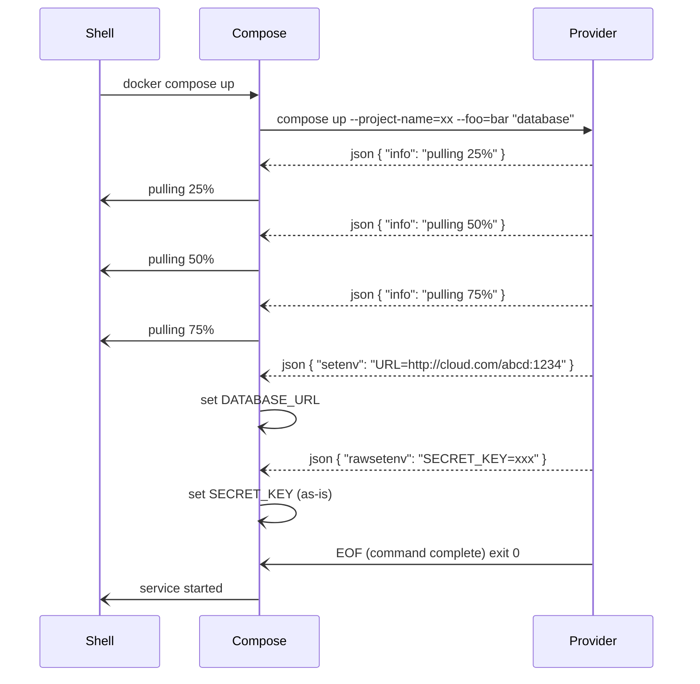
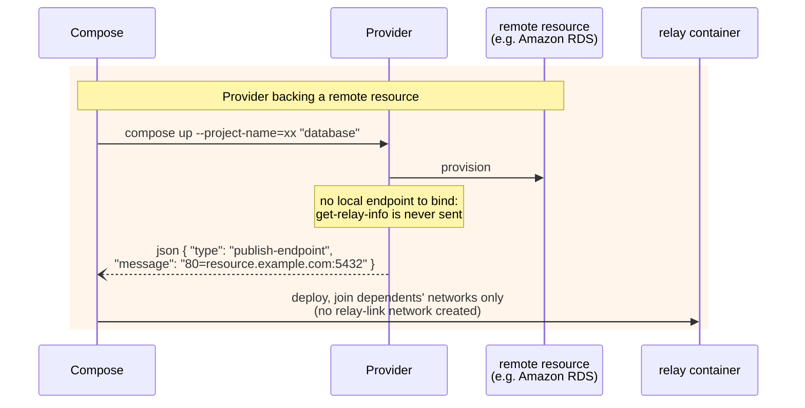
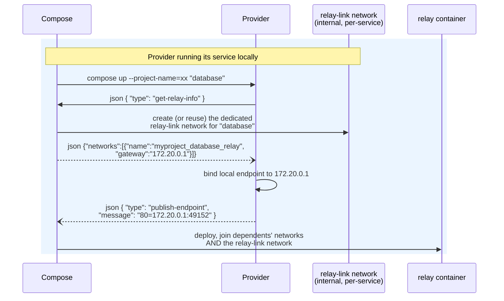

# Docker Compose — Extensions & SDK

Sourced snippets (18 entries). Search this file for the topic;
treat snippets as patterns and reconcile with the installed version.

### Load and start a Compose project using the Go SDK

Source: https://github.com/docker/compose/blob/main/docs/sdk.md

Initializes a Docker CLI client and Compose service instance to load a project configuration from a compose file and start its defined services.

```go
package main

import (
	"context"
	"log"

	"github.com/docker/cli/cli/command"
	"github.com/docker/cli/cli/flags"

	"github.com/docker/compose/v5/pkg/api"
	"github.com/docker/compose/v5/pkg/compose"
)

func main() {
	ctx := context.Background()

	dockerCLI, err := command.NewDockerCli()
	if err != nil {
		log.Fatalf("Failed to create docker CLI: %v", err)
	}
	err = dockerCLI.Initialize(&flags.ClientOptions{})
	if err != nil {
		log.Fatalf("Failed to initialize docker CLI: %v", err)
	}

	// Create a new Compose service instance
	service, err := compose.NewComposeService(dockerCLI)
	if err != nil {
		log.Fatalf("Failed to create compose service: %v", err)
	}

	// Load the Compose project from a compose file
	project, err := service.LoadProject(ctx, api.ProjectLoadOptions{
		ConfigPaths: []string{"compose.yaml"},
		ProjectName: "my-app",
	})
	if err != nil {
		log.Fatalf("Failed to load project: %v", err)
	}

	// Start the services defined in the Compose file
	err = service.Up(ctx, project, api.UpOptions{
		Create: api.CreateOptions{},
		Start:  api.StartOptions{},
	})
	if err != nil {
		log.Fatalf("Failed to start services: %v", err)
	}

	log.Printf("Successfully started project: %s", project.Name)
}
```


--------------------------------

### Declare dependency on a provider-managed service

Source: https://github.com/docker/compose/blob/main/docs/extension.md

Defines an application service dependency on an external provider service in a Compose file. Compose coordinates provider startup before dependent services start.

```yaml
services:
  app:
    image: myapp 
    depends_on:
       - database

  database:
    provider:
      type: awesomecloud
```


--------------------------------

### Execute provider compose up command

Source: https://github.com/docker/compose/blob/main/docs/extension.md

Demonstrates the command line invocation used by Compose to execute a provider's up lifecycle with options and project tagging.

```console
awesomecloud compose --project-name <NAME> up --type=mysql --size=256 "database"
```


--------------------------------

### Customize SDK Behavior with NewComposeService Options

Source: https://github.com/docker/compose/blob/main/docs/sdk.md

Pass optional compose.Option arguments to compose.NewComposeService to redirect I/O streams, control max concurrency, and set automated prompt confirmations.

```go
	// Create a custom output buffer to capture logs
	var outputBuffer bytes.Buffer

	// Create a compose service with custom options
	service, err := compose.NewComposeService(dockerCLI,
		compose.WithOutputStream(&outputBuffer),      // Redirect output to custom writer
		compose.WithErrorStream(os.Stderr),           // Use stderr for errors
		compose.WithMaxConcurrency(4),                // Limit concurrent operations
		compose.WithPrompt(compose.AlwaysOkPrompt()), // Auto-confirm all prompts
	)
```


--------------------------------

### Query extension metadata and inspect JSON response format

Source: https://github.com/docker/compose/blob/main/docs/extension.md

Run the metadata subcommand without parameters to output a JSON structure detailing parameters accepted by extension commands. The returned metadata enables validation, auto-completion, and documentation generation in Docker Compose.

```console
awesomecloud compose metadata
```

```json
{
  "description": "Manage services on AwesomeCloud",
  "up": {
    "parameters": [
      {
        "name": "type",
        "description": "Database type (mysql, postgres, etc.)",
        "required": true,
        "type": "string"
      },
      {
        "name": "size",
        "description": "Database size in GB",
        "required": false,
        "type": "integer",
        "default": "10"
      },
      {
        "name": "name",
        "description": "Name of the database to be created",
        "required": true,
        "type": "string"
      }
    ]
  },
  "down": {
    "parameters": [
      {
        "name": "name",
        "description": "Name of the database to be removed",
        "required": true,
        "type": "string"
      }
    ]
  },
  "stop": {
    "parameters": [
      {
        "name": "name",
        "description": "Name of the database to be stopped",
        "required": true,
        "type": "string"
      }
    ]
  },
  "pull": {
    "parameters": []
  }
}
```


--------------------------------

### Sequence diagram of Compose provider communication flow

Source: https://github.com/docker/compose/blob/main/docs/extension.md

Illustrates the sequence of messages exchanged between the Shell, Compose, and the Provider extension during a compose up operation.




--------------------------------

### get-service-config

Source: https://github.com/docker/compose/blob/main/docs/extension.md

Requests the resolved, canonical definition of the managed service directly from the running Compose process via standard I/O. Compose responds on stdin with the normalized service JSON definition.

```APIDOC
## get-service-config

### Description
Asks the running Compose process for the resolved definition of the service managed by the provider. The request is sent as a JSON line on `stdout`, and Compose responds with one JSON line on `stdin`.

### Protocol
JSON line over standard I/O (`stdout` -> `stdin`)

### Request Format
```json
{
  "type": "get-service-config"
}
```

### Parameters
None. A provider can only obtain the definition of its own service.

### Response Format
One JSON line on `stdin` containing the resolved, canonical JSON of the service (matching `docker compose config --format json` after interpolation and normalization).

```json
{
  "image": "mysql:8",
  "environment": {
    "...": "..."
  }
}
```

### Error Handling
- If Compose does not support provider requests, it treats the request as a protocol error, writes nothing to `stdin`, and closes the stream (EOF).
```


--------------------------------

### Remote resource provider relay workflow sequence

Source: https://github.com/docker/compose/blob/main/docs/extension.md

Sequence diagram demonstrating the workflow for a remote provider that skips get-relay-info and publishes its remote address directly.




--------------------------------

### Configure custom provider for a service

Source: https://github.com/docker/compose/blob/main/docs/extension.md

Defines a service with a custom `provider` attribute specifying the external runtime binary and its options. If `provider.type` does not resolve to a Docker CLI plugin or PATH executable, Compose returns an error and interrupts `up`.

```yaml
  database:
    provider:
      type: awesomecloud
      options:
        type: mysql
        size: 256
        name: myAwesomeCloudDB
```


--------------------------------

### Request and receive relay network information with get-relay-info

Source: https://github.com/docker/compose/blob/main/docs/extension.md

Send get-relay-info from a local provider to declare local binding and receive the assigned internal bridge network and gateway IP. Providers backing remote resources should skip this message.

```json
{ "type": "get-relay-info" }
```

```json
{"networks":[{"name":"myproject_database_relay","gateway":"172.20.0.1"}]}
```


--------------------------------

### Emit exact environment variable with rawsetenv

Source: https://github.com/docker/compose/blob/main/docs/extension.md

Send a rawsetenv message from a provider command to inject a variable into dependent services without a prefix. Colliding keys overwrite existing service environment variables with a warning.

```json
{"type": "rawsetenv", "message": "SECRET_KEY=xxx"}
```


--------------------------------

### Local provider endpoint binding and relay workflow sequence

Source: https://github.com/docker/compose/blob/main/docs/extension.md

Sequence diagram showing the interaction flow between Compose, the local provider, the dedicated relay-link network, and the relay container.




--------------------------------

### Emit prefixed environment variable with setenv

Source: https://github.com/docker/compose/blob/main/docs/extension.md

Send a setenv message from a provider command to inject a configuration variable into dependent services. Compose automatically prefixes the variable name with the provider service name (e.g., DATABASE_URL).

```json
{"type": "setenv", "message": "URL=https://awesomecloud.com/db:1234"}
```


--------------------------------

### Invoke provider pull command

Source: https://github.com/docker/compose/blob/main/docs/extension.md

Compose invokes this command on the provider extension during the image phase of up or during docker compose pull when the provider declares a pull block in metadata.

```console
awesomecloud compose --project-name <NAME> pull --image=<ref> --source=<verdict> --policy=<policy> [--digest=<id> --created=<time>] "database"
```


--------------------------------

### Request image bytes and receive image stream response

Source: https://github.com/docker/compose/blob/main/docs/extension.md

The provider emits a get-image JSON line on stdout to request image content, and Compose responds on stdin with an image-stream JSON header followed by chunked tar data.

```json
{ "type": "get-image", "message": "<image ref>", "platform": "linux/arm64" }
```

```json
{ "type": "image-stream", "encoding": "chunked", "media-type": "application/x-tar" }
```


--------------------------------

### Request and receive resolved service configuration

Source: https://github.com/docker/compose/blob/main/docs/extension.md

Send a JSON request on stdout to retrieve the resolved, normalized definition of the managed service, which Compose returns as a JSON line on stdin. Versions of Compose that predate this message abort the command and send EOF.

```json
{ "type": "get-service-config" }

```

```json
{ "image": "mysql:8", "environment": { "...": "..." } }

```


--------------------------------

### Emit info status update message

Source: https://github.com/docker/compose/blob/main/docs/extension.md

Sends a JSON line-delimited message over stdout to report service status. Compose renders this message as the service state in the progress UI.

```json
{ "type": "info", "message": "preparing mysql ..." }
```


--------------------------------

### Publish network endpoint location

Source: https://github.com/docker/compose/blob/main/docs/extension.md

Declares reachable TCP endpoints using '<container-port>=<host>:<port>'. When published, Compose deploys a relay container to provide compose-native addressing for dependent services.

```json
{ "type": "publish-endpoint", "message": "80=localhost:49152" }
```
